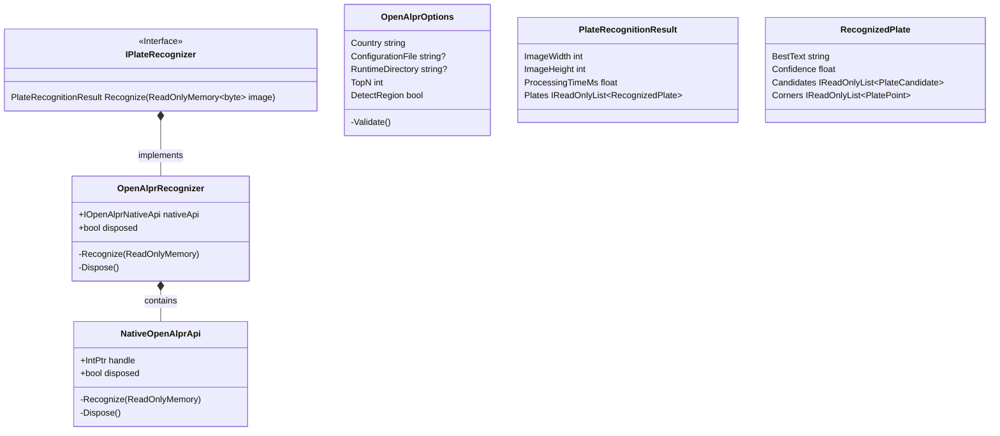
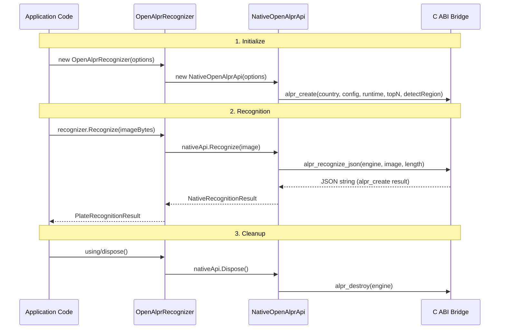

# Architecture

OpenALPRWrapper 架構設計與內部實現詳解

## 🏗️ Overview

OpenALPRWrapper 是一個 P/Invoke 橋接庫，提供 .NET 應用程式對 OpenALPR native C API 的封裝。採用**依賴倒轉（Dependency Inversion）**和**資源確定性釋放（Deterministic Resource Disposal）**模式。

## 📐 Layered Architecture



## 🔄 Component Flow

### Recognition Lifecycle



## 🛠️ Design Patterns

### 1. P/Invoke Bridge Pattern

```csharp
internal sealed class NativeOpenAlprApi : IOpenAlprNativeApi
{
    private const string LibraryName = "openalpr_dotnet";
    private readonly IntPtr handle;
    private bool disposed;

    public void Recognize(ReadOnlyMemory<byte> image)
    {
        // P/Invoke to native C API
        [DllImport(LibraryName, EntryPoint = "alpr_recognize_json")]
        internal static extern IntPtr Recognize(IntPtr engine, IntPtr image, nuint length);
    }
}
```

**優點：**
- ✅ 隔離 native 依賴於 managed 代碼
- ✅ 支持跨平台二進位互換
- ✅ 保留原始 API 行為

### 2. Resource Deterministic Disposal

```csharp
public void Dispose()
{
    if (disposed) return;
    Native.Destroy(handle); // alpr_destroy(engine)
    disposed = true;
}
```

**資源管理：**
- `alpr_create` → 返回 IntPtr handle
- `alpr_recognize_json` → 返回 JSON string（需 FreeString）
- `alpr_free_string` → 釋放 JSON 記憶體
- `alpr_destroy` → 銷毀 engine

### 3. Factory Pattern (Internal)

```csharp
private static IOpenAlprNativeApi CreateNativeApi(OpenAlprOptions options)
{
    ArgumentNullException.ThrowIfNull(options);
    options.Validate(); // Path validation
    return new NativeOpenAlprApi(options);
}
```

### 4. Dependency Injection (Internal Boundary)

```csharp
internal OpenAlprRecognizer(OpenAlprOptions options, IOpenAlprNativeApi nativeApi)
{
    ArgumentNullException.ThrowIfNull(options);
    ArgumentNullException.ThrowIfNull(nativeApi);
    options.Validate();
    this.nativeApi = nativeApi;
}
```

**Testability：**
- Mock IOpenAlprNativeApi 可注入測試中
- FakeNativeApi 用於單元測試（見 Tests）

## 📦 Data Flow Diagram

```mermaid
flowchart TD
    A[Application Code] -->|new OpenAlprRecognizer(options)| B(OpenAlprRecognizer)
    B -->|Create Native API| C[NativeOpenAlprApi]
    
    C -->|P/Invoke: alpr_create| D[Native Library .so/.dll]
    D -->|Returns IntPtr handle| C
    
    A -->|recognize(imageBytes)| B
    B -->|Call Recognize()| C
    C -->|P/Invoke: alpr_recognize_json| D
    D -->|Returns JSON string| C
    
    C -->|Parse JSON| E[Managed Result Objects]
    E -->|PlateRecognitionResult| A
    
    A -->|Dispose/recogizer| B
    B -->|Destroy Engine| C
    C -->|alpr_destroy| D
```

## 🔒 Error Handling Strategy

### Exception Hierarchy

```csharp
public sealed class OpenAlprException : Exception
{
    // Wraps native-level exceptions with context
    public OpenAlprException(string message, Exception? innerException = null);
}
```

**Error Categories:**

| 類別 | 例外類型 | 處理方式 |
|------|----------|----------|
| Initialization Failed | `OpenAlprException` (handle == IntPtr.Zero) | Native library not found or runtime data missing |
| Missing Library | `DllNotFoundException` → Wrapped as `OpenAlprException` | Platform-specific .so/.dll not installed |
| Missing Export | `EntryPointNotFoundException` → Wrapped as `OpenAlprException` | Expected C API symbols not exported |
| Empty Image | `ArgumentException` | Image data is empty |
| Recognition Failed | `OpenAlprException` (handle == IntPtr.Zero) | No plate detected or invalid image |
| JSON Parse Error | `OpenAlprException` | Truncated/malformed JSON response |

### Null Reference Prevention

```csharp
public NativeOpenAlprApi(OpenAlprOptions options)
{
    ArgumentNullException.ThrowIfNull(options); // Early failure
    handle = Native.Create(...);
    
    if (handle == IntPtr.Zero)
        throw new OpenAlprException("Failed to initialize...", null);
}
```

## 🧪 Testing Architecture

### Unit Test Structure

```csharp
namespace OpenAlprWrapper.Tests
{
    public sealed class OpenAlprRecognizerTests
    {
        [Fact]
        public void Constructor_NullOptions_ThrowsArgumentNullException()
            // Validates argument checking
        
        [Fact]
        public void Recognize_EmptyResults_ReturnsEmptyPlates()
            // Validates edge case: no plates detected
        
        [Fact]
        public void Recognize_MultiplePlates_ReturnsCorrectStructure()
            // Validates multi-plate recognition
        
        [Fact]
        public void StressTest_MultipleRecognizeDisposeCycles_DoesNotLeak()
            // 100+ cycles to verify no resource leaks
    }
}
```

### Fake Implementation Pattern

```csharp
private sealed class FakeNativeApi : IOpenAlprNativeApi
{
    public NativeRecognitionResult Result { get; set; } = new(0, 0, 0, []);
    public int DisposeCount { get; private set; }
    
    public NativeRecognitionResult Recognize(ReadOnlyMemory<byte> image) => Result;
    public void Dispose() => DisposeCount++;
}
```

**優點：**
- ✅ Isolated unit testing without native dependency
- ✅ Verify managed layer logic independently
- ✅ Test error scenarios without platform-specific binaries

## 🔧 Build & Deployment Architecture

### NuGet Package Structure

```
OpenAlprWrapper.0.1.0.nupkg/
├── lib/net10.0/
│   ├── OpenAlprWrapper.dll      (Managed assembly)
│   └── OpenAlprWrapper.xml      (XML documentation)
├── [Content_Types].xml          (Package manifest)
└── README.md                    (Installation guide)

OpenAlprWrapper.0.1.0.snupkg/
└── symbols                      (PDB files for debugging)
```

### Native Assets Configuration

`nativeAssets.json`:

```json
{
  "windows": {
    "x64": { "libraryPath": "./win-x64/" },
    "arm64": { "libraryPath": "./win-arm64/" }
  },
  "linux": {
    "x64": { "libraryPath": "./linux-x64/" },
    "arm64": { "libraryPath": "./linux-arm64/" }
  },
  "osx": {
    "x64": { "libraryPath": "./osx-x64/" },
    "arm64": { "libraryPath": "./osx-arm64/" }
  }
}
```

**CI/CD Integration：**
- Use GitHub Actions or Azure DevOps for cross-platform native builds
- Bundle pre-compiled binaries as NuGet assets (optional, advanced)
- Or require users to install OpenALPR separately

## 📊 Performance Considerations

### Memory Management

| 操作 | 記憶體影響 | 最佳化措施 |
|------|-----------|------------|
| P/Invoke call | Minimal (IntPtr marshalling) | Using var pin for image bytes |
| JSON parsing | Medium (JsonDocument.Parse) | FreeString() in finally block |
| Result objects | Low (record structs) | Single-pass materialization |

### Recommended Usage Patterns

```csharp
// ✅ GOOD: Use 'using' statement for automatic disposal
using var recognizer = new OpenAlprRecognizer(options);

// ✅ GOOD: Reuse recognizer if configuration unchanged
var recognizerFactory = () => new OpenAlprRecognizer(options);

// ⚠️ AVOID: Create new recognizer per image (suboptimal)
foreach (var image in images)
{
    var recognizer = new OpenAlprRecognizer(options); // Inefficient
}
```

### Processing Time Expectations

| 圖片尺寸 | 預期處理時間 | Notes |
|----------|--------------|-------|
| 640×480 | ~10-20ms | Low-resolution images |
| 1280×720 | ~20-50ms | HD quality |
| 1920×1080+ | ~30-100ms | FHD and above |

---

**Last Updated:** 2026-11-12  
**Author:** OpenALPRWrapper Contributors  
**License:** AGPL-3.0-only
