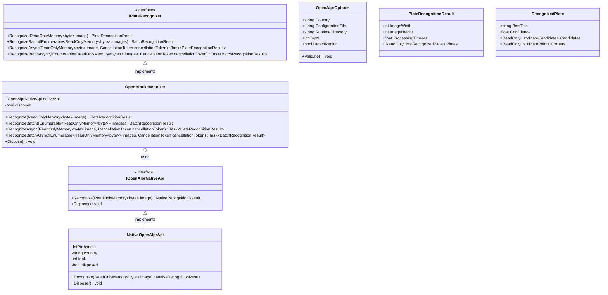
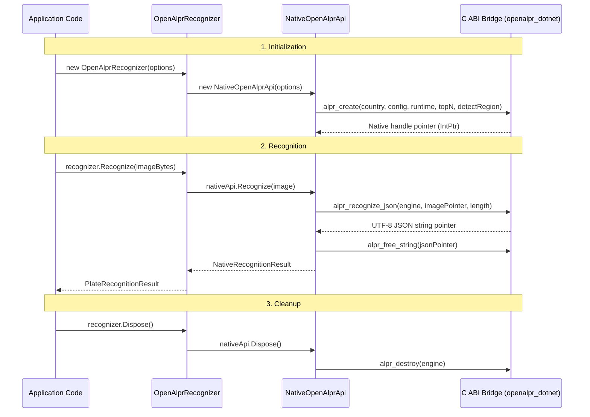
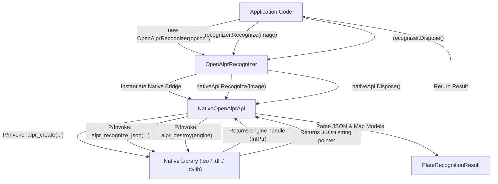

# Architecture

Detailed architectural design and internal implementation of OpenALPRWrapper.

## 🏗️ Overview

OpenALPRWrapper is a managed P/Invoke bridge library that provides .NET applications with an idiomatic, high-performance wrapper around the native OpenALPR C API. It is designed around **Dependency Inversion** and **Deterministic Resource Disposal**.

## 📐 Layered Architecture



## 🔄 Component Flow

### Recognition Lifecycle



## 🛠️ Design Patterns

### 1. P/Invoke Bridge Pattern

The native bridge pattern isolates platform-specific C calls behind internal P/Invoke declarations:

```csharp
internal sealed class NativeOpenAlprApi : IOpenAlprNativeApi
{
    private const string LibraryName = "openalpr_dotnet";
    private readonly IntPtr handle;
    private bool disposed;

    public unsafe NativeRecognitionResult Recognize(ReadOnlyMemory<byte> image)
    {
        using var pin = image.Pin();
        var jsonPointer = Native.Recognize(handle, (IntPtr)pin.Pointer, (nuint)image.Length);
        // ... parse JSON response and free string ...
    }

    private static class Native
    {
        [DllImport(LibraryName, EntryPoint = "alpr_recognize_json", CallingConvention = CallingConvention.Cdecl)]
        internal static extern IntPtr Recognize(IntPtr engine, IntPtr image, nuint length);

        [DllImport(LibraryName, EntryPoint = "alpr_free_string", CallingConvention = CallingConvention.Cdecl)]
        internal static extern void FreeString(IntPtr value);
    }
}
```

**Key Benefits:**
- ✅ Isolates native platform dependencies from managed consumer code
- ✅ Supports cross-platform binary interop across Linux, Windows, and macOS
- ✅ Preserves native C API performance without redundant object allocations

### 2. Deterministic Resource Disposal

Native memory allocations and C++ engine instances are managed using the `IDisposable` pattern:

```csharp
public void Dispose()
{
    if (disposed) return;
    Native.Destroy(handle); // Invokes alpr_destroy(engine)
    disposed = true;
}
```

**Resource Management Lifecycle:**
- `alpr_create` → Returns an `IntPtr` handle to the allocated native C++ engine
- `alpr_recognize_json` → Returns a heap-allocated UTF-8 JSON string pointer
- `alpr_free_string` → Frees the native JSON string buffer within a `finally` block
- `alpr_destroy` → Destroys the engine instance and deallocates native resources

### 3. Factory Pattern (Internal)

Validation is performed before native engine allocation:

```csharp
private static IOpenAlprNativeApi CreateNativeApi(OpenAlprOptions options)
{
    ArgumentNullException.ThrowIfNull(options);
    options.Validate(); // Validates country code and file paths
    return new NativeOpenAlprApi(options);
}
```

### 4. Dependency Injection (Internal Boundary)

To ensure full unit testability without requiring compiled native binaries, `OpenAlprRecognizer` provides an internal constructor accepting `IOpenAlprNativeApi`:

```csharp
internal OpenAlprRecognizer(OpenAlprOptions options, IOpenAlprNativeApi nativeApi)
{
    ArgumentNullException.ThrowIfNull(options);
    ArgumentNullException.ThrowIfNull(nativeApi);
    options.Validate();
    this.nativeApi = nativeApi;
}
```

**Testability:**
- Mock implementations of `IOpenAlprNativeApi` can be injected during testing
- `FakeNativeApi` verifies managed parsing and error handling in CI pipelines without native dependencies

## 📦 Data Flow Diagram



## 🔒 Error Handling Strategy

### Exception Hierarchy

```csharp
public sealed class OpenAlprException : Exception
{
    // Wraps native-level errors and initialization failures with rich context
    public OpenAlprException(string message, Exception? innerException = null);
}
```

**Error Categories:**

| Category | Exception Type | Handling Strategy |
|----------|----------------|-------------------|
| Initialization Failed | `OpenAlprException` (`handle == IntPtr.Zero`) | Native library missing or runtime data path invalid |
| Missing Library | `DllNotFoundException` | Platform-specific `.so`, `.dll`, or `.dylib` not installed |
| Missing Export | `EntryPointNotFoundException` | Required C ABI symbols not exported from library |
| Empty Image | `ArgumentException` | Image data empty or zero length |
| Recognition Failed | `OpenAlprException` | Native API returned null result |
| JSON Parse Error | `OpenAlprException` (wrapped `JsonException`) | Truncated or malformed JSON payload from native bridge |

### Null Reference & Fail-Early Prevention

```csharp
public NativeOpenAlprApi(OpenAlprOptions options)
{
    ArgumentNullException.ThrowIfNull(options);

    this.country = options.Country;
    handle = Native.Create(this.country, options.ConfigurationFile ?? string.Empty,
        options.RuntimeDirectory ?? string.Empty, this.topN = options.TopN, options.DetectRegion ? 1 : 0);
    
    if (handle == IntPtr.Zero)
        throw new OpenAlprException($"Failed to initialize OpenALPR engine for country '{options.Country}' with TopN={options.TopN}. Ensure native runtime data files are installed.", null);
}
```

## 🧪 Testing Architecture

### Unit Test Structure

```csharp
namespace OpenAlprWrapper.Tests
{
    public sealed class OpenAlprRecognizerTests
    {
        [Fact]
        public void Constructor_NullOptions_ThrowsArgumentNullException()
            // Validates argument preconditions
        
        [Fact]
        public void Recognize_EmptyResults_ReturnsEmptyPlates()
            // Validates edge case where no plates are detected
        
        [Fact]
        public void Recognize_MultiplePlates_ReturnsCorrectStructure()
            // Validates parsing multiple plates and candidates
        
        [Fact]
        public void StressTest_MultipleRecognizeDisposeCycles_DoesNotLeak()
            // Validates stability over 100+ cycles
    }
}
```

### Fake Implementation Pattern

```csharp
private sealed class FakeNativeApi : IOpenAlprNativeApi
{
    public NativeRecognitionResult Result { get; set; } = new(0, 0, 0, []);
    public int DisposeCount { get; private set; }
    
    public NativeRecognitionResult Recognize(ReadOnlyMemory<byte> image) => Result;
    public void Dispose() => DisposeCount++;
}
```

**Key Benefits:**
- ✅ Isolated unit testing without requiring native runtime dependencies
- ✅ Independent verification of managed business logic and error propagation
- ✅ Reliable test execution on CI runners lacking native OpenCV/OpenALPR installations

## 🔧 Build & Deployment Architecture

### NuGet Package Structure

```
OpenAlprWrapper.0.1.0.nupkg/
├── lib/
│   ├── net10.0/
│   │   ├── OpenAlprWrapper.dll      (Managed assembly)
│   │   └── OpenAlprWrapper.xml      (XML documentation)
│   └── net8.0/
│       ├── OpenAlprWrapper.dll
│       └── OpenAlprWrapper.xml
├── [Content_Types].xml              (Package manifest)
└── README.md                        (Package readme)

OpenAlprWrapper.0.1.0.snupkg/
└── symbols                          (PDB symbol files for source debugging)
```

### Native Assets Configuration

`nativeAssets.json`:

```json
{
  "windows": {
    "x64": { "libraryPath": "./win-x64/" },
    "arm64": { "libraryPath": "./win-arm64/" }
  },
  "linux": {
    "x64": { "libraryPath": "./linux-x64/" },
    "arm64": { "libraryPath": "./linux-arm64/" }
  },
  "osx": {
    "x64": { "libraryPath": "./osx-x64/" },
    "arm64": { "libraryPath": "./osx-arm64/" }
  }
}
```

**CI/CD Integration:**
- Use automated build runners for cross-platform native compilation
- Package platform-specific native binaries into target distribution packages
- Provide fallback paths to system-installed OpenALPR dynamic libraries

## 📊 Performance Considerations

### Memory Management

| Operation | Memory Impact | Optimization Strategy |
|-----------|---------------|-----------------------|
| P/Invoke call | Minimal (`IntPtr` pinning) | `ReadOnlyMemory<byte>.Pin()` avoids heap copy |
| JSON parsing | Medium (`JsonDocument.Parse`) | Deterministic `FreeString()` in `finally` block |
| Result objects | Low (record types) | Single-pass materialization into immutable lists |

### Recommended Usage Patterns

```csharp
// ✅ RECOMMENDED: Reuse recognizer instance across multiple images
var options = new OpenAlprOptions { Country = "us", TopN = 10 };
using var recognizer = new OpenAlprRecognizer(options);

foreach (var image in images)
{
    var result = recognizer.Recognize(image);
}

// ⚠️ AVOID: Creating a new recognizer per image (incurs engine initialization overhead)
foreach (var image in images)
{
    using var recognizer = new OpenAlprRecognizer(options); // Inefficient
    recognizer.Recognize(image);
}
```

### Processing Time Expectations

| Image Resolution | Expected Processing Time | Notes |
|------------------|--------------------------|-------|
| 640×480 | ~10–20 ms | Standard recognition resolution |
| 1280×720 | ~20–50 ms | High Definition (720p) |
| 1920×1080+ | ~30–100 ms | Full HD (1080p) and above |

---

**Last Updated:** 2026-11-12  
**Author:** OpenALPRWrapper Contributors  
**License:** AGPL-3.0-only
